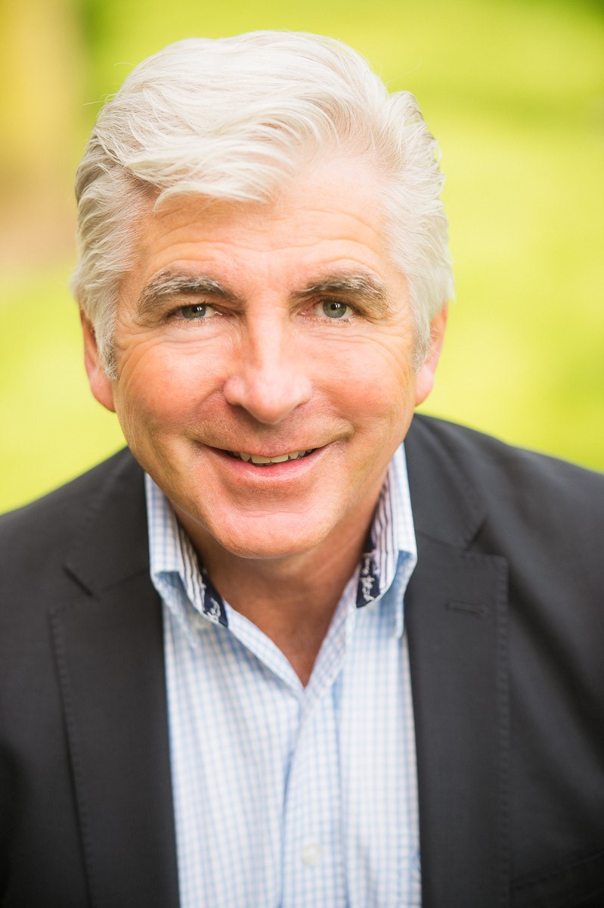

Mick Kelly, MBA, CFP

[Experience](#experience)[Advisory](#advisory)[About](#about)[Contact](#contact)

# Governance advice from someone who has held the seat.

Director and consultant to boards and executive teams. Three terms on city council, seats on hospital, library and regional boards, a career in financial services, and a company built from lease situations to employee purchases and executive operations.

[Start a conversation](#contact)[See the record](#experience)

## A record of service and building

Banking and public service, then a company of my own. Each taught a different side of oversight.

1. 1985–2000

   ### Sales and management positions, Bank of Montreal, Investors Group, Royal Bank and HSBC Bank

   Fifteen years across four financial institutions, building a grounding in sales, client relationships and management.
2. 1990

   ### President, Penticton Chamber of Commerce

   Led the local business community’s voice to council and the public.
3. 1990–1998

   ### Councillor, City of Penticton (three terms)

   Also sat on the Regional District, the hospital board and the library board, balancing budgets and service needs across public bodies.
4. 2000–2016

   ### Senior Consultant, Regional Vice President and National Vice President Sales, Standard Life

   Helped develop and implement a business consultancy program guiding small business owners on marketing, client segmentation and operational efficiency. As National Vice President, oversaw a staff of nearly 1,000 and the sales operations for commercial planning and sales development.
5. 2019–2023

   ### Lead co-founder, Crossmedia Canada (Sensea Immersive)

   Led incorporation, lease agreements, facility construction, operating structure and all marketing, with HR and expense oversight in a COO role. Wound the company down in 2023 and moved the equipment to Mexico.
6. Now

   ### Virtual reality facility, Panama City

   Working with my partner at Crossmedia Mexico to open a facility in mid 2027.

## How I can help a board

Engagements are remote, with travel where it adds value.

### Governance practice

Clear roles between board and management, sound meeting rhythm, and decisions that stand up to scrutiny.

### Growth and strategy oversight

Pressure-testing plans, segmentation and go-to-market choices from a founder’s and a banker’s point of view.

### Financial and operational oversight

Reading the numbers, asking about controls and expenses, and spotting where operations drift from the plan.

### Community and stakeholder relations

Drawing on years in elected office, chambers and tourism bodies to navigate public and civic stakeholders.

## About

My path to the boardroom was not a straight line. I started out as a pilot in training with the Canadian Armed Forces, and worked as a lifeguard, a muffler shop hand, a gas pipeline worker and a representative in the insurance industry.

Public office taught me how to serve many stakeholders at once. Banking taught me discipline with other people’s money. Building a company taught me what it feels like when the plan meets the reality of operations and people.

I am based in Panama and open to remote board and advisory roles, with some travel.

Credentials

MBA, CFP

Governance

Chamber president, city councillor, hospital, library and regional district boards, strata councils

Memberships

Tourism Vancouver, Destination BC, Delta Chamber of Commerce

Location

Panama, available remotely

## Let’s talk about your board

Whether you are filling a seat or strengthening the table you have, I am glad to start with a conversation.

[Email me](mailto:gmickkelly@hotmail.com)[Connect on LinkedIn](https://www.linkedin.com/in/mickkellymbacfp/)

gmickkelly@hotmail.com

© 2026 Mick Kelly. Based in Panama. [gmickkelly@hotmail.com](mailto:gmickkelly@hotmail.com)
